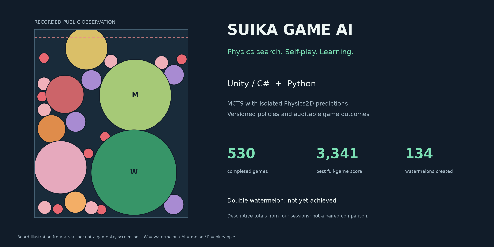
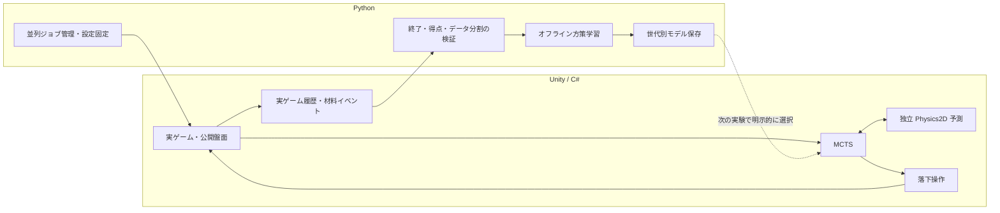

# SuikaGameAI

**Unityの物理シミュレーションで未来を探索し、自己対戦の経験から方策を更新するスイカゲームAI。**

Physics-based MCTS and versioned self-play learning, built with Unity / C# and Python.

[](https://github.com/takezodasai/SuikaGameAI/actions/workflows/python-tests.yml)



[Unityなしで試す](#unityなしで試す) · [設計と担当範囲](docs/ENGINEERING.md) · [実測結果](docs/RESULTS.md) · [最新の材料育成実験](docs/LATEST_CURRICULUM_RESULTS.md) · [実行・テスト](docs/REPRODUCIBILITY.md)

## 何を作っているか

既存のUnityゲーム基盤に、MCTS、独立した物理予測、Pythonとの通信、並列実験、学習・検証の仕組みを追加しています。
最終目標は高得点とダブルスイカの安定達成です。**ダブルスイカは未達成で、学習モデルが基準MCTSより強いこともまだ確認できていません。**

| 技術的な取り組み | 実装内容 |
|---|---|
| 物理を利用する探索 | 独立したPhysics2D環境で落下・合体・GOを予測し、MCTSで候補を比較 |
| 長時間実行の安定化 | 予測Sceneの解放、メモリ・通信の監査、ジョブ単位の中断・再開 |
| 実験の再現性 | ゲーム乱数と探索乱数の分離、設定・モデルSHA固定、自然GOと打ち切りの区別 |
| 経験からの学習 | 小型方策によるrollout、実測returnを使う重み付き模倣学習、世代別保存 |
| 材料育成の観測 | スイカ＋メロン／パイナップルなどを、実ゲームの合体通知で記録 |

## Unityなしで試す

**Python 3.12とNumPyだけ**で、同梱の実ログ由来の盤面と小型方策を読み込み、5候補の確率を計算できます。
Unity、GPU、大規模ログは不要です。

```powershell
git clone https://github.com/takezodasai/SuikaGameAI.git
Set-Location SuikaGameAI
py -3.12 -m venv .venv
.\.venv\Scripts\python.exe -m pip install numpy==2.2.3
.\.venv\Scripts\python.exe Python\examples\portfolio\demo.py
```

```text
x=0.00  probability=0.2036
x=0.25  probability=0.2049
x=0.50  probability=0.2173
x=0.75  probability=0.1961
x=1.00  probability=0.1781
Policy argmax: 0.5
```

これは**rollout方策の推論デモ**です。MCTSや物理計算を実行せず、この確率だけで実ゲームの最善手が分かるものではありません。
実際のMCTSは物理予測と即時GOの除外を含めて最終手を選びます。
盤面は開発用データから採取しており、独立した性能評価には使いません。[出所](Python/examples/portfolio/provenance.json)

## 最新モデルをUnity画面で1ゲーム見る

[画面付きプレイの再現手順](docs/GUI_MODEL_PREVIEW.md)を用意しています。Unity 2022.3.21f1で表示用Playerをビルドした後、リポジトリルートで実行します。過去のデータセットは不要です。

```powershell
py -3.12 Python/play_public_model.py
```

実際の果物・得点・NEXTが見えるゲーム画面で、最新の公開凍結方策を使ったMCTSが通常開始から1ゲーム操作します。256反復・深さ4・固定5候補。同期探索中は画面が一時停止します。Escで停止でき、学習やモデル更新は行いません。短い確認は `--max-drops 3 --game-seconds 120`。モデルの強さの改善は未確認です。

## システム構成



通常の制御ツールにはUDP通信もあります。学習用LabではUnityが自動プレイし、Pythonがプロセスとログを管理します。
ゲーム中にモデルを書き換えず、学習後も自動昇格させません。

## 実測したこと

2026-11-11に確認した4セッションでは、自然GO **530ゲーム**、最高 **3,341点**、新規スイカ **134個**、ダブルスイカ **0回**でした。
条件は256反復・深さ4・固定5候補・学習rollout混合率0.5。seedとモデル世代が異なるため、平均値の差を強化の証拠にはしていません。
[セッション別の結果](docs/RESULTS.md)と[公開集計JSON](Python/examples/portfolio/results.json)を掲載しています。

2026-11-12の材料育成セッションでは、通常開始112ゲームと近似盤面続行112ゲームが全件自然GOで完了しました。
近似盤面の続行で、**スイカ＋メロン＋パイナップルの新規共存を1件**観測しました。途中成果であり、ダブルスイカ達成ではありません。
[初期状態・新規達成・続行成績を分けた結果](docs/LATEST_CURRICULUM_RESULTS.md)

## 検証と再現性

- Python回帰テストをGitHub Actionsで実行する構成を追加しています。[workflow](.github/workflows/python-tests.yml)
- Unityの短時間検証では材料観測20項目・ルール127項目・MCTS861項目が通過しました。Unity検証はローカル実施でCIには含めません。
- 旧Player／新Playerの観測ON・OFF各3手で、比較した公開物理状態・操作tick・実ゲーム乱数・root統計が一致しました。長時間の完全一致の証明ではありません。
- 打ち切りを自然GOの0点ゲームにせず、未観測イベントを失敗ラベルに変換しません。
- Train／Validationは元ゲームseedや初期系列でまとめ、同じ盤面の反復を独立試行として数えません。

[クリーンな環境でのテスト手順](docs/REPRODUCIBILITY.md)

## 現在の限界

- 接触履歴など、Unity内部状態をスナップショットから完全には復元できません。近似盤面の続行は厳密な反実仮想ではありません。
- 方策更新は結果重み付き模倣学習です。未選択行動の真の価値や最適方策を直接学んだものではありません。
- 中間成果ボーナスは実験用です。通常得点を下げる可能性もあり、OFFモデルと別保存します。
- Player、大規模ログ、学習データセットはGitに含めません。一部の研究スクリプトはローカル資産を必要とします。
- 削除された旧Test予約情報を完全には復旧できていません。既知の開発データを未使用Testとして扱わず、将来の最終評価は別途予約したseedで行う方針です。

## 読む順番

1. [設計・追加開発の範囲・学んだこと](docs/ENGINEERING.md)
2. [実測結果と比較上の注意](docs/RESULTS.md)
3. [短い再現手順](docs/REPRODUCIBILITY.md)
4. [材料育成の学習環境](docs/MATERIAL_PROGRESS_LEARNING_ENVIRONMENT.md)

主な実装： [MCTS](Unity/Assets/Scenes/Script/MctsPlanner.cs) / [物理予測](Unity/Assets/Scenes/Script/SuikaPhysicsSimulator.cs) / [学習rollout](Unity/Assets/Scenes/Script/LearnedRolloutPlanner.cs) / [収集・学習](Python/double_watermelon_learning.py) / [材料観測](Unity/Assets/Scenes/Script/SuikaMaterialProgress.cs)

動画はまだ掲載していません。上の画像は実ログの可視化で、ゲーム画面や録画ではありません。[動画の構成案](docs/DEMO_VIDEO_PLAN.md)

## 開発について

個人開発プロジェクトです。既存Unityゲーム基盤を利用し、主にAI・通信・実験・学習機能を追加しています。
実装・調査・テスト作成には生成AI（Codex）を活用しています。実測・回帰テスト・採用しなかった結果も記録する方針です。
このREADMEはゲーム基盤や素材をすべて独自制作したと主張するものではありません。

開発ブランチは`develop`。Unity **2022.3.21f1**、Python **3.12**で検証しています。時系列資料は[開発記録](docs/DEVELOPMENT_LOG.md)に保存しています。
